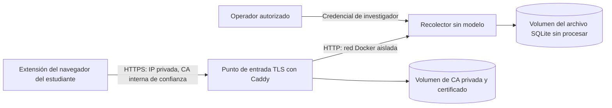

# Preparar la captura para investigación en la red universitaria

Este despliegue independiente recolecta sesiones de investigación sobre una **dirección IPv4 privada** fija. No arranca PostgreSQL, el conversor, un servicio de inferencia ni descargas de modelos. El Compose de desarrollo existente y el flujo normal de protección permanecen separados.

**Estado:** se entregan los artefactos de despliegue local y las pruebas sintéticas. No se ha accedido ni desplegado en ningún servidor universitario. Antes del trabajo de campo deben comprobarse la aprobación institucional, la alcanzabilidad real de la red, el endurecimiento del host, la instalación de confianza en los clientes y el ensayo con el proveedor real. TLS protege el transporte, no el archivo sin procesar, el almacenamiento del navegador ni el historial externo del chatbot.

## Límite del despliegue

Solo se publica el punto de entrada TLS, en la IP de host elegida y el puerto TCP 443. El recolector escucha en el puerto 8000 únicamente dentro de Docker. Ambos contenedores se ejecutan con UID/GID 10001, sistemas de archivos raíz de solo lectura, capacidades de Linux retiradas y límites de recursos y logs. El archivo y el estado de la CA usan volúmenes nombrados persistentes. Es un servicio piloto de un solo host, no una plataforma multiusuario auditada y de alta disponibilidad.

El proxy se une a un puente de ingreso y a la red aislada de recolección; el recolector se une solo a la segunda. Una red de Docker solo interna no es un mecanismo de publicación de ingreso. El proxy escucha en el puerto no privilegiado 8443 detrás del puerto 443 del host, y la imagen elimina la capacidad de archivo `cap_net_bind_service` innecesaria del binario original. `default_sni` selecciona el certificado de la IP configurada para clientes que omiten SNI; la verificación de IP y SAN del cliente sigue activa.

La configuración por defecto usa la CA interna de Caddy. Una CA institucional puede reemplazarla más adelante bajo el procedimiento de certificados de TI; eso no se configura automáticamente. Caddy no puede instalar confianza en equipos propiedad de los estudiantes desde dentro del contenedor del servidor. **No** desactives las comprobaciones de certificado del navegador, no pidas a los estudiantes que omitan advertencias, no uses `curl -k` ni desactives la verificación en el código de la aplicación.

## 1. Preparar el host y el paquete local

Requisitos: un host autorizado por la universidad con contenedores Linux y Docker Compose v2, Python 3.12 o superior para la preparación, una dirección IPv4 RFC1918 fija y almacenamiento cifrado y restringido en el host. Docker Desktop puede usarse para el ensayo; la institución debe aprobar el sistema operativo definitivo del host, las licencias y el procedimiento de operación. Confirma que el equipo no se suspende y que su firewall permite TCP 443 **solo desde la subred universitaria aprobada**. Una dirección interna por sí sola no evita una exposición accidental por firewall o NAT. No abras puertos públicos ni configures redirección de puertos.

Desde la raíz del repositorio, usando PowerShell:

~~~powershell
# Estos son valores ficticios de ensayo. Reemplázalos por la IP fija real de TI,
# el protocolo aprobado y la retención aprobada antes de recolectar con participantes.
python deployment/research/prepare.py --ip 10.20.30.40 --output workspace/research-deployment --protocol research-v1 --retention-days 7
$Run = (Resolve-Path workspace/research-deployment).Path
$ComposeArgs = @("compose", "--env-file", "$Run/.env", "-f", "compose.research.yaml")
docker @ComposeArgs config --quiet
~~~

El comando crea un directorio nuevo únicamente; se niega a sobrescribir salidas, claves o datos existentes. Rechaza direcciones públicas, de loopback, link-local, nombres de host y direcciones mal formadas. IPv6 y puertos HTTPS personalizados no están soportados por este comando de preparación del paquete. También puede ejecutarlo el Python de un entorno virtual local existente; no hace falta instalar paquetes adicionales.

Archivos generados:

| Ruta dentro del directorio de salida | Quién lo recibe |
|---|---|
| `.env` | Solo el operador: configuración y rutas locales de los archivos de secretos, no las claves en claro |
| `secrets/admin.txt` | Solo el operador: exportación, eliminación de registros y purga por expiración |
| `secrets/enrollment.txt` | Participantes autorizados del estudio por el canal de configuración aprobado; solo creación de sesiones |
| `extension/` | Paquete del participante, con el permiso de host exacto `https://<IP-privada>/*` y el endpoint público; **sin clave embebida** |

No compartas el directorio de salida completo ni lo pongas en un commit. La salida debe estar fuera del repositorio o dentro de su `workspace/`, que está ignorado. En sistemas de archivos POSIX, el comando de preparación crea directorios contenedores privados `0700`; los archivos de secretos son legibles por el contenedor no root (`0444`) porque los montajes de archivos locales de Compose no reasignan el propietario. Por eso el límite del directorio es esencial. En Windows, los modos de Python **no** son una ACL NTFS de solo operador: pide a TI que restrinja la carpeta de salida a la cuenta del operador o del servicio y al acceso necesario del servicio de Docker antes de generar credenciales reales del estudio. No apliques cambios de permisos a todo el repositorio ni a las carpetas personales de los estudiantes. Los secretos de archivo de Compose son montajes locales de archivos, no un servicio de gestión de secretos cifrado.

El código de inscripción es un secreto de cohorte, **no** una inscripción de un solo uso, ni verificación de identidad, ni un límite de cantidad de participantes. Cualquiera que lo posea puede crear sesiones adicionales hasta que se rote. Distribúyelo solo durante sesiones aprobadas y supervisadas, rótalo entre cohortes, restringe el acceso de red y vigila la capacidad del host y del disco. La clave de administrador nunca debe introducirse en la extensión de campus, en Forms ni en un chatbot. Las capacidades de subida y retiro específicas de cada sesión siguen siendo distintas de ambas claves.

## 2. Compilar y arrancar en el host autorizado

Este paso descarga y compila imágenes de contenedor según haga falta y crea volúmenes persistentes. No reutiliza ni migra la base de datos de desarrollo.

~~~powershell
docker @ComposeArgs up -d --build --wait --wait-timeout 90
docker @ComposeArgs ps
docker @ComposeArgs cp proxy:/data/caddy/pki/authorities/local/root.crt "$Run/university-research-root.crt"
~~~

Ejecuta estos comandos **en el host aprobado**, después de recrear allí los archivos locales de preparación. Las rutas de secretos generadas son absolutas y propias del host; no copies un `.env` de Windows sin cambios a Linux. El repositorio no descubre hosts remotos, no transfiere archivos ni reutiliza credenciales SSH.

La comprobación de salud del recolector lee los secretos configurados y abre el archivo. Secretos faltantes o ilegibles, demasiado cortos, claves de inscripción y administración idénticas o una retención inválida hacen fallar la disponibilidad con un error genérico de configuración. Producción define `RESEARCH_REQUIRE_ENROLLMENT=true`: allí ni siquiera la cabecera de administrador puede iniciar sesiones. No hay recarga de desarrollo, montaje de fuentes, migración de arranque ni dependencia de inferencia.

Los logs de error de los contenedores están acotados; no se habilitan los logs de acceso a peticiones ni el modo de depuración. No habilites el registro de cuerpos o cabeceras de petición para texto identificable. No se instala ningún programador automático de expiración ni de respaldos.

## 3. Establecer confianza en cada equipo de participante

1. Exporta **solo** `university-research-root.crt`. Nunca distribuyas `/data`, las claves privadas raíz o intermedias, el archivo, los secretos del operador ni respaldos completos de volúmenes.
2. Pide a TI que verifique el certificado y comunique su huella SHA-256 por un canal de confianza independiente. Los estudiantes deben compararla antes de importar. No establezcas confianza descargando un certificado no comprobado por HTTP desde la misma red no confiable.
3. Explica que confiar en una CA raíz otorga una autoridad amplia de firma de certificados en ese almacén de confianza, no un permiso limitado a esta IP. Protege las claves privadas de la CA y obtén autorización explícita para instalar confianza en los clientes. Prefiere el aprovisionamiento de confianza gestionado por la institución cuando exista.
4. En Windows y Chrome, una instalación aprobada por usuario puede usar el siguiente comando **después de la verificación**, ejecutado por el estudiante o por un operador de TI autorizado:

   ~~~powershell
   $Certificate = Import-Certificate -FilePath ./university-research-root.crt -CertStoreLocation Cert:\CurrentUser\Root
   $Certificate.Thumbprint
   ~~~

   Conserva la huella devuelta para poder eliminarlo. No importes una clave privada ni un PFX, y no instales en el almacén de todos los usuarios sin autorización institucional. Otros sistemas operativos y navegadores requieren su propio procedimiento de almacén de confianza aprobado por TI. Firefox no ha sido validado por esta implementación; no supongas que la configuración de confianza o el paquete de Chrome son suficientes.
5. Reinicia el navegador si hace falta. Abre `https://<IP-privada-real>/api/research/health` desde la red universitaria. Debes obtener `{"status":"ready"}` **sin advertencia de certificado**. El certificado debe coincidir con la IP; un nombre DNS, otra IP o un certificado expirado no son equivalentes.
6. Carga solo la copia generada `extension/` en el perfil de navegador dedicado y aprobado. El popup muestra la dirección de la API de investigación. Confirma que coincide con la IP aprobada, no con localhost. Introduce el código de inscripción de la cohorte y el protocolo aprobado; revisa el consentimiento antes de iniciar.

La extensión no puede otorgar confianza, suprimir errores de TLS ni saltarse un permiso de host denegado. Su paquete de fuentes por defecto sigue siendo local; solo la copia de campus generada añade el host HTTPS exacto. Esto es preparación de una extensión descomprimida, no publicación en la Web Store, distribución empresarial firmada ni instalador automático. TI debe elegir el mecanismo de distribución aprobado.

Cuando termine el estudio, detén la recolección y resuelve los guardados y retiros pendientes antes de desinstalar nada. En Windows, elimina **solo esta raíz importada y verificada**, usando la huella registrada:

~~~powershell
# Reemplaza el marcador por la huella exacta registrada al importar.
Remove-Item -LiteralPath "Cert:\CurrentUser\Root\<huella-registrada>"
~~~

No elimines raíces institucionales ajenas. Limpia el almacenamiento local sin procesar del estudio solo bajo el proceso aprobado de retención y retiro; quitar la confianza no borra registros.

## 4. Ensayar antes de reclutar

- Usa texto ficticio y un chat compatible nuevo. Verifica manualmente los adaptadores actuales de editor, envío y respuesta del sitio; los fixtures automáticos no establecen compatibilidad con el proveedor real.
- Inicia, envía, espera la respuesta renderizada, finaliza y copia el recibo confirmado. Verifícalo con la credencial de investigador. El código de inscripción y el recibo por sí solos no deben permitir exportar registros.
- Prueba una interrupción temporal de red: el lote congelado debe permanecer local, el recibo no debe aparecer antes de tiempo y el reintento debe devolver el mismo código. No cambies la IP ni el paquete mientras haya una sesión pendiente.
- Confirma el guardado correcto desde **otro equipo de la red universitaria**; el ensayo local con Docker no demuestra el firewall, el aislamiento de clientes o VLAN ni el enrutamiento real del campus.
- Reinicia el host y el servicio y verifica la persistencia del archivo y de la CA, el monitoreo de capacidad y el procedimiento de respaldo y recuperación del operador. Un corte de energía no es una estrategia de retención aprobada.
- Revisa las [condiciones de preparación del estudio](../project/experimentacion/research-study/README.md) y los [límites de la captura](research-capture.md). No sustituyas la falta de aprobación ética o de consentimiento con un ensayo técnico exitoso.

Las sesiones nuevas se atan al origen de API del paquete. Las subidas pendientes, el retiro de sesiones guardadas y los reintentos conservan el origen usado al iniciar, aunque un paquete posterior apunte a otro lugar. Las sesiones locales antiguas sin origen siguen usando el origen local original del middleware. Finaliza o descarta las sesiones locales de ensayo antes de instalar un paquete de campus; cambiar la configuración no migra datos ni capacidades.

## Operación, respaldo y recuperación

**Detener sin borrar datos:** `docker @ComposeArgs stop`. **Reanudar:** `docker @ComposeArgs up -d --wait`. No uses `down --volumes`, poda de volúmenes ni borres el directorio de salida en un despliegue de estudio. Perder el volumen del archivo pierde registros; perder el volumen de la CA exige un nuevo despliegue de confianza. El acceso root a Docker o al servicio puede leer datos sin procesar y claves privadas.

Usa la API de respaldo de SQLite para obtener una instantánea consistente del archivo en línea, no una copia ciega durante escrituras. Ejemplo desde PowerShell; la salida contiene datos identificables sin procesar y debe permanecer en almacenamiento cifrado y aprobado:

~~~powershell
$BackupName = "capture-" + (Get-Date -Format "yyyyMMdd-HHmmss") + ".sqlite3"
$BackupCode = "import sqlite3; src=sqlite3.connect('/data/capture.sqlite3'); dst=sqlite3.connect('/data/$BackupName'); src.backup(dst); dst.close(); src.close()"
docker @ComposeArgs exec -T collector python -c $BackupCode
docker @ComposeArgs cp "collector:/data/$BackupName" "$Run/$BackupName"
~~~

Comprueba la integridad de la instantánea (`PRAGMA integrity_check`) y prueba la restauración en un host aislado antes de confiar en ella. Conserva por separado un respaldo cifrado y restringido del estado de la CA y de los secretos del operador; nunca entregues ese respaldo a los participantes. Documenta la propiedad, la expiración, la eliminación y los derechos de restauración del respaldo. La instantánea dentro del volumen también necesita expiración y eliminación; crear otra copia no cumple la retención. No se afirma respaldo remoto automático, cifrado completo del host, recuperación ante desastres probada ni borrado seguro de medios físicos.

Para ensayar la restauración, detén un recolector de prueba separado, copia la instantánea aprobada de SQLite en su volumen de archivo como `capture.sqlite3`, restaura la propiedad UID/GID 10001 y permisos restrictivos, arráncalo y verifica un recibo sintético conocido con autorización. No sobrescribas el archivo en vivo. Restaura el estado de la CA solo mediante el procedimiento restringido de respaldo de TI; una CA recién generada no es la identidad anterior. Registra evidencia real de restauración antes del trabajo de campo.

Una tarea diaria aprobada en el host puede ejecutar la ruta de purga existente sin poner su clave en los argumentos de la línea de comandos:

~~~powershell
$PurgeCode = "from pathlib import Path; import urllib.request; key=Path('/run/secrets/research_admin').read_text().strip(); req=urllib.request.Request('http://127.0.0.1:8000/api/research/purge-expired', method='POST', headers={'X-Research-Key':key}); print(urllib.request.urlopen(req, timeout=30).read().decode())"
docker @ComposeArgs exec -T collector python -c $PurgeCode
~~~

El comando informa un conteo de eliminaciones. La expiración impide la exportación y finalización normales, pero los bytes no se eliminan automáticamente hasta que se ejecuta la purga. Alinea la vinculación con Forms, las instantáneas y los respaldos con la política de retención aprobada. `secure_delete` de SQLite no garantiza un borrado forense en SSD ni en respaldos.

Para rotar credenciales, detén la nueva inscripción, crea secretos aleatorios nuevos y distintos en la carpeta restringida, actualiza las referencias locales de los archivos y recrea el recolector con `up -d --force-recreate collector`. Verifica la salud y que el código de inscripción anterior falle antes de redistribuir el nuevo. Las capacidades de las sesiones existentes siguen siendo válidas hasta el retiro o la expiración; rotar la inscripción no las revoca. Cambiar el consentimiento o el protocolo del estudio requiere el proceso aprobado del estudio, no editar la casilla de un participante en ejecución.

## Verificación y límites

~~~powershell
e2e/.venv/Scripts/python.exe -m pytest e2e/tests/test_research_deployment.py -q
# Descarga y compila imágenes si hace falta; solo elimina su proyecto y volúmenes locales aleatorios.
e2e/.venv/Scripts/python.exe -m pytest e2e/tests/test_research_production.py -q
~~~

Las pruebas de preparación verifican el rechazo de direcciones y protocolos, la negativa a sobrescribir, secretos distintos, el permiso de host exacto añadido y el manifest de origen sin cambios. La prueba de producción usa una **sobreescritura solo de loopback**, credenciales sintéticas nuevas, una CA interna temporal y volúmenes aislados. Comprueba el rechazo de TLS no confiable, TLS de confianza con validación de nombre de host, separación de permisos, guardado y reintento, persistencia tras reiniciar y retiro. No altera el almacén de confianza de la estación de trabajo ni usa `verify=False`. Observa el resultado de la prueba antes de afirmar que estas comprobaciones pasaron; el ensayo real de campus, navegador y proveedor sigue siendo independiente.

Observado el 2026-10-30: pruebas de preparación **8 pasadas**, pruebas de controlador y aislamiento en Node **14 pasadas**, suite de la API **70 pasadas / 2 omisiones por PostgreSQL local** (una advertencia de deprecación preexistente de TestClient), y suite de navegador y preparación sin contenedores **21 pasadas / 3 casos de Docker deseleccionados**. Un ensayo separado de Docker/TLS de producción **pasó**. El caso de navegador de campus usa un endpoint HTTP de loopback solo para pruebas para verificar la inscripción y el cableado del paquete; la prueba de producción separada valida TLS. Esto no afirma que se haya probado el almacén de confianza de un estudiante real ni un adaptador de proveedor en la nube.

La selección final de integración con Docker también pasó **3 pruebas / 21 deseleccionadas en 73,19 segundos**, incluidos el nuevo despliegue TLS y los contratos existentes de adjuntos, PostgreSQL y API. Así, las dos selecciones finales de e2e cubren los 24 casos sin contar las pruebas deseleccionadas como aprobadas. No se realizó una revisión delegada independiente, siguiendo la restricción del usuario de trabajar solo en línea.

Durante el ensayo de producción, la inspección con depurador identificó y corrigió el fallo de ejecución de la capacidad de archivo original, la publicación del puerto solo interno y la selección de certificado por IP sin SNI. Una ejecución de navegador superpuesta también encontró un bloqueo compartido del perfil sintético; la suite secuencial aislada pasó. No se usó ninguna omisión de validación de certificados del host ni del navegador para obtener un resultado aprobado.

El servicio actual tiene cuerpos, conteos de eventos, concurrencia de API y recursos de contenedor acotados, pero no invitaciones de un solo uso, cuotas por participante, auditoría externa, limitador de tasa distribuido, aplicación automática de cuota de disco ni host redundante. Mantén el piloto supervisado y probado en capacidad; no lo expongas a Internet ni lo llames plataforma general de investigación en producción.

## Evidencia y páginas relacionadas

- [HTTPS interno de Caddy y confianza del cliente](https://caddyserver.com/docs/automatic-https#local-https), [emisor interno](https://caddyserver.com/docs/caddyfile/directives/tls): el aprovisionamiento de confianza raíz es responsabilidad del cliente y del administrador.
- [Secretos de Docker Compose](https://docs.docker.com/compose/how-tos/use-secrets/), [despliegue en producción](https://docs.docker.com/compose/how-tos/production/): montajes de archivos y configuración de producción separada.
- [Permisos de host de Chrome](https://developer.chrome.com/docs/extensions/develop/concepts/declare-permissions): el paquete generado añade un host en lugar de un acceso HTTPS opcional sin restricciones.
- [Guía de captura local](research-capture.md), [arquitectura de investigación](../architecture/backend/privacy-middleware/research-capture.md), [kit del estudio con estudiantes](../project/experimentacion/research-study/README.md).
