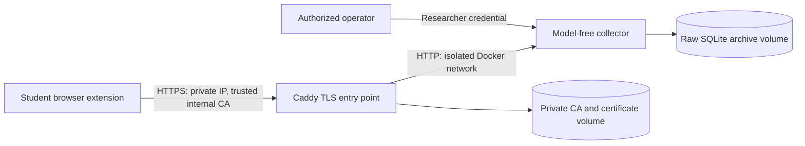

# Prepare research capture on the university network

This standalone deployment collects research sessions over a fixed **private IPv4 address**. It does not start PostgreSQL, the converter, an inference service or model downloads. The existing development Compose and normal protection flow remain separate.

**Status:** local deployment artifacts and synthetic tests are provided. No university server has been accessed or deployed. Institutional approval, actual network reachability, host hardening, client trust installation and live-provider rehearsal must be checked before fieldwork. TLS protects transport, not the raw archive, browser storage or external chatbot history.

## Deployment boundary

Only the TLS entry point is published, on the selected host IP and TCP port 443. The collector listens on port 8000 inside Docker only. Both containers run as UID/GID 10001 with read-only root filesystems, dropped Linux capabilities and resource/log limits. The archive and CA state use persistent named volumes. This is a single-host pilot service, not a highly available, audited multi-tenant platform.

The proxy joins an ingress bridge and the isolated collection network; the collector joins only the latter. An internal-only Docker network is not an ingress publishing mechanism. The proxy listens on unprivileged port 8443 behind host port 443, and the image removes the upstream binary's unnecessary `cap_net_bind_service` file capability. `default_sni` selects the configured IP certificate for clients that omit SNI; client IP/SAN verification remains enabled.

The default setup uses Caddy's internal CA. An institutional CA can replace it later under IT's certificate procedure; that is not configured automatically. Caddy cannot install trust on student-owned computers from inside the server container. Do **not** disable browser certificate checks, tell students to bypass warnings, use `curl -k`, or disable verification in application code.

## 1. Prepare the host and local package

Prerequisites: a university-authorized host with Linux containers/Docker Compose v2, Python 3.12 or later for preparation, a fixed RFC1918 IPv4 address, and encrypted/restricted host storage. Docker Desktop may be used for rehearsal; the institution must approve the eventual host OS, licensing and operating procedure. Confirm that the computer stays awake and its firewall permits TCP 443 **only from the approved university subnet**. An internal address alone does not prevent an unintended firewall/NAT exposure. Do not open public ports or configure port forwarding.

From the repository root, using PowerShell:

~~~powershell
# These are fictional rehearsal values. Replace with IT's actual fixed IP,
# approved protocol and approved retention before participant collection.
python deployment/research/prepare.py --ip 10.20.30.40 --output workspace/research-deployment --protocol research-v1 --retention-days 7
$Run = (Resolve-Path workspace/research-deployment).Path
$ComposeArgs = @("compose", "--env-file", "$Run/.env", "-f", "compose.research.yaml")
docker @ComposeArgs config --quiet
~~~

The command creates a new directory only; it refuses to overwrite existing output, keys or data. It rejects public, loopback, link-local, hostname and malformed addresses. IPv6/custom HTTPS ports are not supported by this package-preparation command. An existing local virtual environment's Python can also run it; no extra package installation is needed.

Generated files:

| Path inside the output directory | Who receives it |
|---|---|
| `.env` | Operator only: configuration and local secret-file paths, not raw keys |
| `secrets/admin.txt` | Operator only: export, record deletion and expiry purge |
| `secrets/enrollment.txt` | Authorized study participants through the approved setup channel; session creation only |
| `extension/` | Participant package, with the exact `https://<private-IP>/*` host permission and public endpoint; **no embedded key** |

Do not share the entire output directory or put it in a commit. Output must be outside the repository or under its ignored `workspace/`. On POSIX filesystems, the preparation command creates private `0700` enclosing directories; secret files are readable by the non-root container (`0444`) because local Compose file mounts do not remap ownership. The directory boundary is therefore essential. On Windows, Python modes are **not** an operator-only NTFS ACL: ask IT to restrict the output folder to the operator/service account and required Docker service access before generating real study credentials. Do not apply permission changes to the whole repository or student home folders. Compose file secrets are local file mounts, not an encrypted secret-management service.

The enrollment code is a cohort secret, **not** single-use enrollment, identity verification or a participant count limit. Anyone possessing it can create additional sessions until it is rotated. Distribute only during supervised approved sessions, rotate between cohorts, restrict network access and monitor host/disk capacity. The administrator key must never be entered into the campus extension, Forms or a chatbot. Session-specific upload/withdrawal capabilities remain separate from both keys.

## 2. Build and start on the authorized host

This step downloads/builds container images as needed and creates persistent volumes. It does not reuse or migrate the development database.

~~~powershell
docker @ComposeArgs up -d --build --wait --wait-timeout 90
docker @ComposeArgs ps
docker @ComposeArgs cp proxy:/data/caddy/pki/authorities/local/root.crt "$Run/university-research-root.crt"
~~~

Run these commands **on the approved host**, after recreating local preparation files there. Generated secret paths are host-local absolute paths; do not copy a Windows `.env` unchanged to Linux. The repository does not discover remote hosts, transfer archives or reuse SSH credentials.

The collector health check reads the configured secrets and opens the archive. Missing/unreadable, too-short, identical enrollment/admin keys or invalid retention cause readiness to fail with a generic configuration error. Production sets `RESEARCH_REQUIRE_ENROLLMENT=true`: even the administrator header cannot start sessions there. No development reload/watch, source bind mount, startup migration or inference dependency is present.

Container error logs are bounded; request access logs and debug mode are not enabled. Do not enable request-body/header logging for identifiable text. No automatic expiry scheduler or backup scheduler is installed.

## 3. Establish trust on every participant computer

1. Export **only** `university-research-root.crt`. Never distribute `/data`, the root/intermediate private keys, the archive, operator secrets or whole volume backups.
2. Have IT verify the certificate and communicate its SHA-256 certificate fingerprint through an independent trusted channel. Students must compare it before importing. Do not bootstrap trust by downloading an unchecked certificate over HTTP from the same untrusted network.
3. Explain that trusting a root CA grants broad certificate-signing authority in that trust store, not permission limited to this one IP. Protect the CA private keys and get explicit authorization for client trust installation. Prefer institution-managed trust provisioning where available.
4. On Windows/Chrome, an approved per-user installation can use the following command **after verification**, run by the student or authorized IT operator:

   ~~~powershell
   $Certificate = Import-Certificate -FilePath ./university-research-root.crt -CertStoreLocation Cert:\CurrentUser\Root
   $Certificate.Thumbprint
   ~~~

   Keep the returned thumbprint for removal. Do not import a private key/PFX or install into all users' stores without institutional authorization. Other operating systems/browsers require their own IT-approved trust-store procedure. Firefox has not been validated by this implementation; do not assume Chrome's trust setup or package is sufficient.
5. Restart the browser if needed. Open `https://<actual-private-IP>/api/research/health` from the university network. Expect `{"status":"ready"}` **with no certificate warning**. The certificate must match the IP; a DNS name, different IP or expired certificate is not equivalent.
6. Load only the generated `extension/` copy in the approved dedicated browser profile. The popup displays the research API address. Confirm it equals the approved IP, not localhost. Enter the cohort enrollment code and approved protocol; review consent before starting.

The extension cannot grant trust, suppress TLS errors or bypass a denied host permission. Its default source package stays local; only the generated campus copy adds the exact HTTPS host. This is unpacked-extension preparation, not Web Store publication, signed enterprise distribution or an automatic installer. IT must choose the approved distribution mechanism.

When the study ends, stop collection and resolve pending saves/withdrawals before uninstalling anything. On Windows, remove **only this verified imported root**, using the recorded thumbprint:

~~~powershell
# Replace the placeholder with the exact thumbprint recorded at import.
Remove-Item -LiteralPath "Cert:\CurrentUser\Root\<recorded-thumbprint>"
~~~

Do not remove unrelated institutional roots. Clear raw local study storage only under the approved retention/withdrawal process; removing trust does not delete records.

## 4. Rehearse before recruiting

- Use fictional text and a fresh supported chat. Verify the current site's editor/send/reply adapters manually; automated fixtures do not establish live provider compatibility.
- Start, submit, wait for the rendered reply, finish, and copy the confirmed receipt. Verify it with the researcher credential. The enrollment code and receipt alone must not export records.
- Test a temporary network interruption: the frozen batch must remain local, the receipt must not appear early, and retry must return the same code. Do not change the IP/package while a session is pending.
- Confirm successful saving from a **different university-network computer**; the local Docker rehearsal does not prove firewall, client-isolation/VLAN or actual campus routing.
- Restart the host/service and verify archive/CA persistence, capacity monitoring and the operator's backup/recovery procedure. A power outage is not an approved retention strategy.
- Review the [study readiness gates](../project/experimentacion/research-study/README.md) and [capture limitations](research-capture.md). Do not replace missing ethics/consent approval with a successful technical rehearsal.

New sessions bind to the package's API origin. Pending uploads, saved-session withdrawal and retries keep the origin used at start, even if a later package points elsewhere. Legacy local sessions without an origin continue using the original local middleware origin. Finish/discard local rehearsal sessions before installing a campus package; changing configuration does not migrate data or capabilities.

## Operations, backup and recovery

**Stop without deleting data:** `docker @ComposeArgs stop`. **Resume:** `docker @ComposeArgs up -d --wait`. Do not use `down --volumes`, volume pruning or delete the output directory on a study deployment. Archive volume loss loses records; CA volume loss requires a new trust rollout. Docker/service root access can read raw data and private keys.

Use the SQLite backup API for a consistent online archive snapshot, not a blind copy during writes. Example from PowerShell; the output contains raw identifiable data and must stay in approved encrypted storage:

~~~powershell
$BackupName = "capture-" + (Get-Date -Format "yyyyMMdd-HHmmss") + ".sqlite3"
$BackupCode = "import sqlite3; src=sqlite3.connect('/data/capture.sqlite3'); dst=sqlite3.connect('/data/$BackupName'); src.backup(dst); dst.close(); src.close()"
docker @ComposeArgs exec -T collector python -c $BackupCode
docker @ComposeArgs cp "collector:/data/$BackupName" "$Run/$BackupName"
~~~

Check snapshot integrity (`PRAGMA integrity_check`) and test restoration on an isolated host before relying on it. Retain a restricted encrypted backup of CA state and operator secrets separately; never give that backup to participants. Document backup ownership, expiry, deletion and restore rights. The in-volume snapshot above also needs expiry/removal; creating another copy does not satisfy retention. No automatic remote backup, full-host encryption, tested disaster recovery or physical-media secure erasure is claimed.

To rehearse restoration, stop a separate test collector, copy the approved SQLite snapshot into its archive volume as `capture.sqlite3`, restore UID/GID 10001 ownership and restrictive permissions, start it and verify an authorized known synthetic receipt. Do not overwrite the live archive. Restore CA state only through IT's restricted backup procedure; a newly generated CA is not the old identity. Record actual restore evidence before fieldwork.

An approved daily host job can run the existing purge route without putting its key in command-line arguments:

~~~powershell
$PurgeCode = "from pathlib import Path; import urllib.request; key=Path('/run/secrets/research_admin').read_text().strip(); req=urllib.request.Request('http://127.0.0.1:8000/api/research/purge-expired', method='POST', headers={'X-Research-Key':key}); print(urllib.request.urlopen(req, timeout=30).read().decode())"
docker @ComposeArgs exec -T collector python -c $PurgeCode
~~~

The command reports a deletion count. Expiry prevents normal export/completion, but bytes are not automatically removed until purge runs. Align Forms linkage, snapshots and backups with the approved retention policy. SQLite `secure_delete` is not a guarantee of forensic erasure on SSDs/backups.

For credential rotation, stop new enrollment, create new distinct random secrets in the restricted folder, update local file references and recreate the collector with `up -d --force-recreate collector`. Verify health and that the old enrollment code fails before redistributing the new code. Existing session capabilities remain valid until withdrawal/expiry; rotating enrollment does not revoke them. Changing study consent/protocol requires the approved study process, not editing a running participant's checkbox.

## Verification and limits

~~~powershell
e2e/.venv/Scripts/python.exe -m pytest e2e/tests/test_research_deployment.py -q
# Downloads/builds images if needed; only its random local project/volumes are removed.
e2e/.venv/Scripts/python.exe -m pytest e2e/tests/test_research_production.py -q
~~~

The preparation tests verify address/protocol rejection, refusal to overwrite, different secrets, exact added host permission and unchanged source manifest. The production test uses a **loopback-only override**, fresh synthetic credentials, a temporary internal CA and isolated volumes. It checks untrusted TLS rejection, trusted TLS with hostname validation, permission separation, save/retry, restart persistence and withdrawal. It does not alter the workstation trust store or use `verify=False`. Observe the test result before claiming these checks passed; actual campus/browser/provider rehearsal remains separate.

Observed on 2026-10-30: preparation tests **8 passed**, Node controller/isolation tests **14 passed**, API suite **70 passed / 2 local PostgreSQL skips** (one pre-existing TestClient deprecation warning), and non-container browser/preparation suite **21 passed / 3 Docker cases deselected**. A separate production Docker/TLS rehearsal **passed**. The campus browser case uses a test-only loopback HTTP endpoint to verify enrollment/package wiring; the separate production test validates TLS. This is not a claim that an actual student's trust store or a real cloud-provider adapter has been tested.

The final Docker integration selection also passed **3 tests / 21 deselected in 73.19 seconds**, including the new TLS deployment and existing attachment/PostgreSQL/API contracts. Thus the two final e2e selections cover all 24 cases without counting deselected tests as passes. No independent delegated review was performed, following the user's inline-only constraint.

During the production rehearsal, debugger inspection identified and corrected the upstream file-capability execution failure, internal-only port publishing, and IP/no-SNI certificate selection. An overlapping browser run also encountered a shared synthetic-profile lock; the isolated sequential suite passed. No host/browser certificate-validation bypass was used to obtain a passing result.

The current service has bounded bodies, event counts, API concurrency and container resources, but no single-use invitations, per-participant quotas, external audit trail, distributed rate limiter, automatic disk-quota enforcement or redundant host. Keep the pilot supervised and capacity-tested; do not expose it to the public Internet or call it a general production research platform.

## Evidence and related pages

- [Caddy internal HTTPS and client trust](https://caddyserver.com/docs/automatic-https#local-https), [internal issuer](https://caddyserver.com/docs/caddyfile/directives/tls): root trust provisioning is a client/administrator responsibility.
- [Docker Compose secrets](https://docs.docker.com/compose/how-tos/use-secrets/), [production deployment](https://docs.docker.com/compose/how-tos/production/): file mounts and separate production configuration.
- [Chrome host permissions](https://developer.chrome.com/docs/extensions/develop/concepts/declare-permissions): the generated package adds one host rather than unrestricted optional HTTPS access.
- [Local capture guide](research-capture.md), [research architecture](../architecture/backend/privacy-middleware/research-capture.md), [student-study kit](../project/experimentacion/research-study/README.md).
