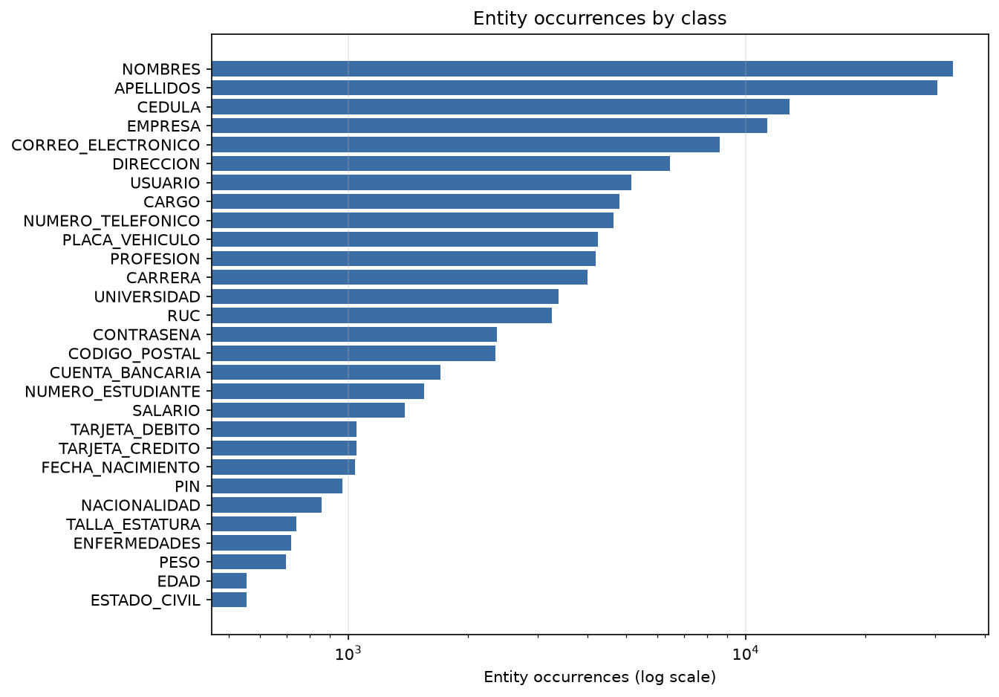
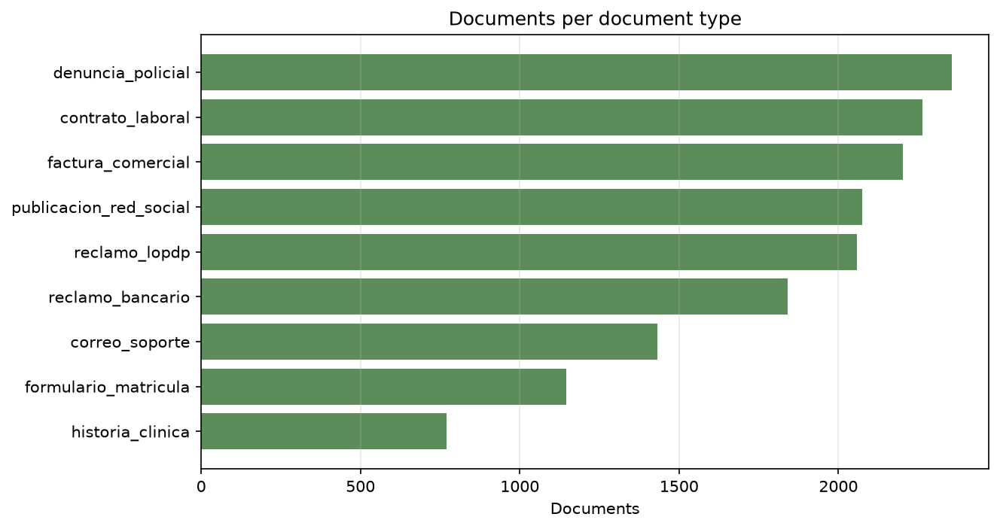
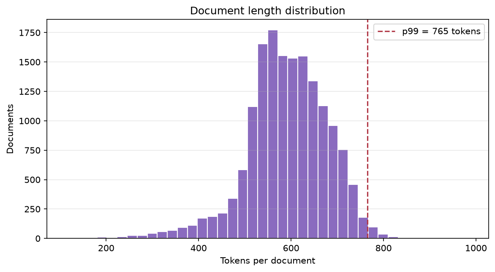
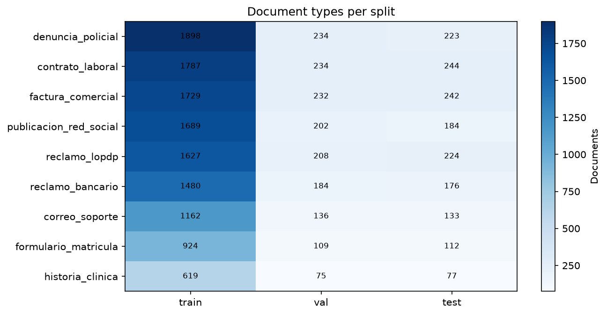
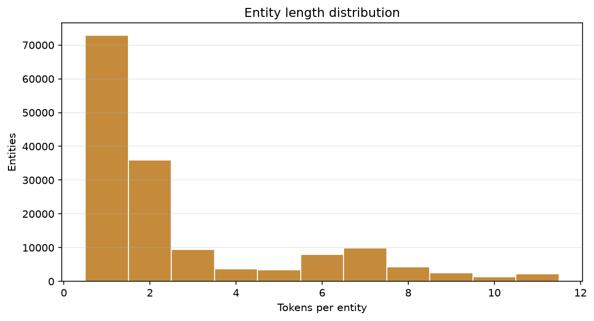

# Dataset Audit v1 — `dataset2`

| Field | Value |
|---|---|
| Status | Completed, read-only audit |
| Dataset version | DVC `md5 5d32321fd6706a62976cba08dff97278.dir` |
| Files / size | 10 files / 311,156,761 bytes (296.73 MiB) |
| Documents | 16,144 |
| Labelled examples | 16,144 |
| Document types | 9 |
| Declared entity types | 31 |
| Observed entity types | 29 |
| Audit evidence | [`notebooks/001_dataset_audit.ipynb`](../notebooks/001_dataset_audit.ipynb) |
| Figures | [`reports/figures/`](figures/) |

This report records the first quality audit of `dataset2`, the raw corpus intended to train the PII detector. It
answers what the dataset contains, how consistent its annotations are, which classes are under-represented, whether
duplicates or leaks exist, and which limitations constrain the next phase. No dataset file was modified.

## Verdict

`dataset2` is structurally sound and ready to enter the preparation phase, with four conditions: the v1 label space
must exclude the two classes without evidence, long documents must be segmented rather than truncated, evaluation
must be per class, and downstream code must treat the BIO tokens as authoritative instead of re-tokenizing raw text.

The dataset is **not** ready for training as delivered: the label space, segmentation, and class weighting still
require decisions that belong to preparation.

## Method and reproducibility

The notebook reads the frozen DVC version, recomputes every metric, and writes the figures in `reports/figures/`. The
audit code lives in `ml/src/pii_ml/data/audit.py` (statistics and detection) and `ml/src/pii_ml/data/validation.py`
(structural and annotation validation). Both modules return plain data; the notebook only presents it.

```powershell
cd ml
uv sync
uv run jupyter nbconvert --to notebook --execute --inplace `
  datasets/dataset2/notebooks/001_dataset_audit.ipynb
```

Runtime is dominated by duplicate detection (about 72 s) and cross-artifact validation (about 34 s) on this machine.

## 1. Inventory

| Artifact | Size | Content |
|---|---:|---|
| `dataset.jsonl` | 60.31 MiB | 16,144 raw documents with declared PII |
| `dataset.xlsx` | 18.59 MiB | Same 16,144 documents, 6 columns, human-readable export |
| `etiquetado/train.jsonl` | 105.70 MiB | 12,915 BIO examples |
| `etiquetado/val.jsonl` | 13.27 MiB | 1,614 BIO examples |
| `etiquetado/test.jsonl` | 13.29 MiB | 1,615 BIO examples |
| `etiquetado/train.conll` | 68.38 MiB | 7,638,564 lines, CoNLL encoding of train |
| `etiquetado/val.conll` | 8.59 MiB | 958,439 lines, CoNLL encoding of val |
| `etiquetado/test.conll` | 8.60 MiB | 959,797 lines, CoNLL encoding of test |
| `etiquetado/labels.txt` | 891 B | 63 tag entries: 31 `B-`, 31 `I-`, and `O` |
| `prueba.json` | 0 B | Empty file, no analytical value |

The inventory matches the DVC metadata exactly: 10 files and 311,156,761 bytes. `dataset.xlsx` and the JSONL/CoNLL
pairs are redundant encodings of the same documents; the JSONL files are the audit source of truth.

## 2. Schema

`dataset.jsonl` has eight fields, all present in 100% of records with consistent types: `id` (int),
`tipo_documento` (str), `pii_incluida` (list), `valores_pii` (dict), `texto` (str), `num_palabras` (int),
`cobertura_pii` (float), and `pii_faltante` (list).

Each labelled split has four fields, all present in 100% of records: `id` (int), `tipo_documento` (str), `tokens`
(list), and `ner_tags` (list). The artifacts join on `id`.

The raw artifact is unusually informative: it declares which PII fields a document should contain and the concrete
values inserted. That declaration allows label verification beyond tag grammar, which is used in Section 8.

## 3. Integrity

| Check | Result |
|---|---|
| Required fields and types | Pass |
| Unique document identifiers | Pass |
| Unique example identifiers per split | Pass |
| Empty documents or examples | Pass |
| Token/tag length agreement | Pass |
| BIO grammar (unknown tags, orphan `I-`) | Pass |
| Split identifier overlap | Pass (0) |
| Split identical-text overlap | Pass (0) |
| Raw documents without a labelled example | Pass (0) |
| Labelled examples without a raw document | Pass (0) |
| Document-type agreement across artifacts | Pass |
| Tokenization alignment | Warning: 1,207 of 16,144 documents (7.5%) |

The single warning is not a label defect. The BIO files split punctuation from words, and for 7.5% of documents the
resulting token boundaries cannot be reproduced exactly from `texto` by punctuation-aware tokenization. Consequences
for preparation: consume `tokens` and `ner_tags` as the authoritative sequence, and never rebuild labels from `texto`
assuming index alignment.

## 4. Labels

The vocabulary declares 31 entity types. Observed entity types are 29; `GENERO` and `HISTORIAL_CLINICO` never occur.
Every observed type includes a `B-` tag, and 18 of the 29 also occur as multi-token entities (11 are single-token in
practice).

| Entity type | Entities | Documents | Share of documents |
|---|---:|---:|---:|
| NOMBRES | 33,281 | 16,143 | 99.99% |
| APELLIDOS | 30,339 | 16,144 | 100.00% |
| CEDULA | 12,880 | 10,431 | 64.61% |
| EMPRESA | 11,325 | 5,475 | 33.91% |
| CORREO_ELECTRONICO | 8,603 | 8,004 | 49.58% |
| DIRECCION | 6,437 | 4,954 | 30.69% |
| USUARIO | 5,149 | 4,202 | 26.03% |
| CARGO | 4,817 | 3,352 | 20.76% |
| NUMERO_TELEFONICO | 4,654 | 4,447 | 27.55% |
| PLACA_VEHICULO | 4,257 | 2,310 | 14.31% |
| PROFESION | 4,197 | 3,246 | 20.11% |
| CARRERA | 3,991 | 2,422 | 15.00% |
| UNIVERSIDAD | 3,375 | 2,204 | 13.65% |
| RUC | 3,257 | 3,071 | 19.02% |
| CONTRASENA | 2,367 | 2,309 | 14.30% |
| CODIGO_POSTAL | 2,342 | 2,261 | 14.01% |
| CUENTA_BANCARIA | 1,707 | 1,534 | 9.50% |
| NUMERO_ESTUDIANTE | 1,552 | 1,392 | 8.62% |
| SALARIO | 1,387 | 1,332 | 8.25% |
| TARJETA_DEBITO | 1,050 | 954 | 5.91% |
| TARJETA_CREDITO | 1,049 | 930 | 5.76% |
| FECHA_NACIMIENTO | 1,038 | 1,023 | 6.34% |
| PIN | 966 | 907 | 5.62% |
| NACIONALIDAD | 855 | 799 | 4.95% |
| TALLA_ESTATURA | 741 | 702 | 4.35% |
| ENFERMEDADES | 719 | 477 | 2.95% |
| PESO | 697 | 604 | 3.74% |
| EDAD | 555 | 528 | 3.27% |
| ESTADO_CIVIL | 555 | 548 | 3.39% |

Total entities: 154,142. Every document contains entities (minimum 5, maximum 91, mean 26.38).



## 5. Distributions

| Document type | Documents | Share |
|---|---:|---:|
| denuncia_policial | 2,355 | 14.6% |
| contrato_laboral | 2,265 | 14.0% |
| factura_comercial | 2,203 | 13.6% |
| publicacion_red_social | 2,075 | 12.9% |
| reclamo_lopdp | 2,059 | 12.8% |
| reclamo_bancario | 1,840 | 11.4% |
| correo_soporte | 1,431 | 8.9% |
| formulario_matricula | 1,145 | 7.1% |
| historia_clinica | 771 | 4.8% |

No document type dominates; the largest holds 14.6% of the corpus. Class imbalance is severe: 60:1 between the most
and least frequent entity type, with seven classes below 1,000 entities.



Document length in tokens: minimum 115, median 592, p90 700, p99 765, maximum 984, mean 590.97. A 512-token
truncation would cut more than half of the documents.



Entity length in tokens: median 2, p90 7, p99 12, maximum 14, mean 2.76.

## 6. Duplicates

| Check | Result |
|---|---:|
| Exact duplicate groups | 0 |
| Exact duplicate documents | 0 |
| Normalized duplicate documents | 0 |
| Near-duplicate candidate pairs (Jaccard ≥ 0.9, shared opening) | 0 |
| Within-split duplicate texts | 0 |

The corpus repeats document templates but not document text. The near-duplicate check only compares documents that
share their first ten normalized words, so it cannot detect a duplicated body with a different opening. This bounds
the risk; it does not prove that no semantic duplicate exists.

## 7. Partitions

| Split | Examples | Share |
|---|---:|---:|
| train | 12,915 | 80.0% |
| val | 1,614 | 10.0% |
| test | 1,615 | 10.0% |

Identifier overlap and identical-text overlap are zero for every pair of splits. The document-type mix is
proportional in all three partitions: every type appears in validation and test at roughly its training share, and no
class is missing from any split.

Direct identifiers never repeat across documents (Section 8), so the random partition does not duplicate an identity.
Repeated names and categorical values cross partitions, but they describe shared vocabulary rather than the same
person.



## 8. Annotation quality

| Check | Result |
|---|---|
| BIO grammar violations | 0 |
| Entities made only of punctuation | 0 |
| Documents with ungrounded declared PII | 0 |
| Declared fields without a value | 0 |
| Declared values absent from the text | 0 |
| Declaration mismatches | 0 |
| Declared `cobertura_pii` | 1.0 in 16,144 of 16,144 documents |
| Tokenization alignment warning | 1,207 documents (7.5%) |

Grounding is exact: every declared PII value appears verbatim in the normalized text of the document that declares
it. This is the strongest quality evidence available for this corpus, because it validates labels against an
independent declaration rather than against the tags themselves.

PII value reuse separates cleanly:

- Direct identifiers are unique per document: `CEDULA`, `CORREO_ELECTRONICO`, `NUMERO_TELEFONICO`,
  `CUENTA_BANCARIA`, `TARJETA_CREDITO`, `TARJETA_DEBITO`, `PLACA_VEHICULO`, `RUC`, and `CONTRASENA` show zero reuse.
- Reuse is concentrated in categorical and descriptive fields: `NACIONALIDAD` has 5 distinct values, `CARRERA` 8,
  `ESTADO_CIVIL` 4, `ENFERMEDADES` 6, `UNIVERSIDAD` 25.
- Names repeat: 918 distinct first names appear in up to 48 documents each.
- 19 of 29 fields have at least one value present in more than one split; none of them is a unique identifier.



## 9. Coverage

| Support level | Classes |
|---|---|
| Fewer than 1,000 documents | 9: ENFERMEDADES (477), EDAD (528), ESTADO_CIVIL (548), PESO (604), TALLA_ESTATURA (702), NACIONALIDAD (799), PIN (907), TARJETA_CREDITO (930), TARJETA_DEBITO (954) |
| Absent from any split | 0 |
| Absent from the dataset | 2: GENERO, HISTORIAL_CLINICO |

Every observed class is present in train, validation, and test, so per-class evaluation is computable everywhere.
The weakest classes are supported by hundreds, not thousands, of documents and will produce unstable metrics unless
training is class-weighted and results are reported per class.

## Limitations

- Duplicate detection is exact plus a prefix-based heuristic; semantic paraphrases are not detected.
- Grounding verifies presence, not correct attachment when the same value occurs several times in one document.
- Label correctness is inferred from the generator declaration; the audit cannot prove that a human annotator would
  label the same spans.
- Coverage thresholds are descriptive; no statistical sufficiency test was applied.
- The audit covers this frozen DVC version only. A new version requires a new run.

## Recommendations for the preparation phase

1. **Freeze the v1 label space at 29 classes.** Exclude `GENERO` and `HISTORIAL_CLINICO`, or produce labelled
   evidence before including them.
2. **Treat `tokens` as authoritative.** Do not re-tokenize `texto` and assume index alignment; 7.5% of documents would
   desynchronize.
3. **Segment long documents with offsets.** Truncation at 512 tokens loses more than half of the documents and their
   spans; the maximum is 984 tokens.
4. **Train with class weights and report per class.** The imbalance is 60:1 and nine classes sit below 1,000
   supporting documents.
5. **Persist the split manifest.** Store the identifier lists of train, validation, and test so later dataset versions
   keep comparable partitions.
6. **Remove `prueba.json` in the next DVC version.** An empty JSON file has no role and should not survive into
   preparation.
7. **Keep `dataset.xlsx` as a review sample only.** The JSONL exports are the single source of truth.

## Next phase gate

The Dataset Audit v1 is complete. The dataset may move to preparation once the label-space decision and the
segmentation strategy are recorded; neither requires modifying this frozen version.
